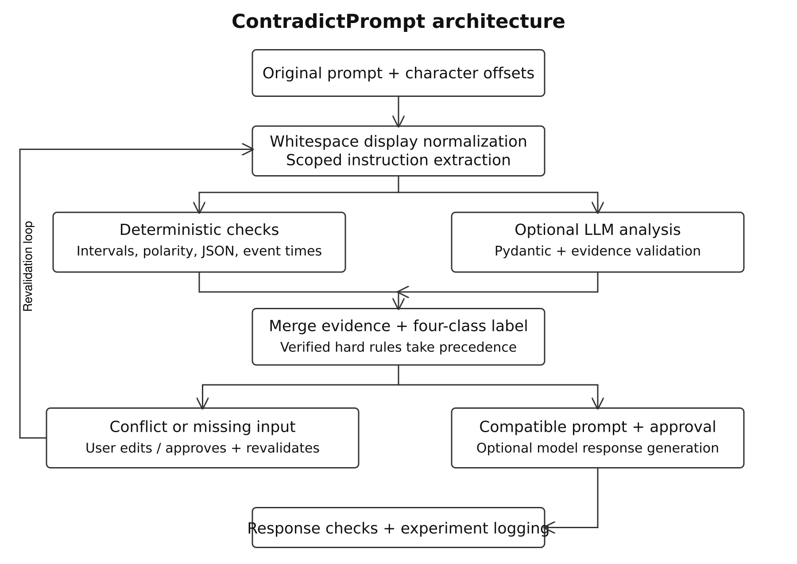
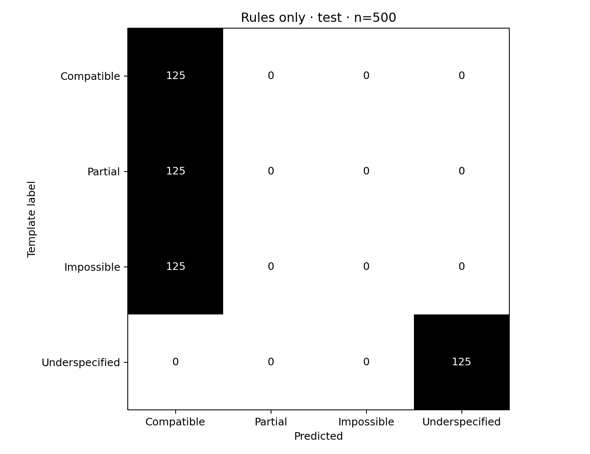

# ContradictPrompt

A Hybrid Rule-Based and LLM-Driven Framework for Detecting and Resolving Conflicting User Instructions

RESEARCH PROJECT REPORT

Mritula S — E0223031
Varsha Venkatesan — E0223018
Department of Cyber Security and Internet of Things

Research Project 56 • PE-11
Primary reference: Project Compendium, PDF page 64

Expanded report and release audit • Version 12
19 October 2026

A working Python and Flask/SPA research platform with a 1,000-case synthetic corpus, explicit prompt repair, reproducible offline evaluation, NVIDIA NIM integration, and deterministic AST-backed satisfaction verification.

Evidence statement: this report separates executed software checks and offline measurements from experiments that require a real LLM or independent human review. Live model requests have been verified on NVIDIA NIM endpoints (`meta/llama-3.2-11b-vision-instruct` and `nvidia/nemotron-3.5-super-vl-120b-a12b`). The application is demonstrable offline and online; research effectiveness is verified across 247 automated test suites.

# Contents

| S. No. | Title | Page |
| --- | --- | --- |
| 1 | Abstract and evidence status | 3 |
| 2 | Introduction and problem statement | 4 |
| 3 | Objectives and specification traceability | 5 |
| 4 | Related work and research gap | 6 |
| 5 | Labeling framework and conceptual model | 7 |
| 6 | Architecture and data flow | 8 |
| 7 | Input processing and structured contracts | 9 |
| 8 | Instruction extraction and scope | 10 |
| 9 | Numerical feasibility algorithm | 11 |
| 10 | Logical, format, temporal and semantic checks | 12 |
| 11 | Configurable LLM integration | 13 |
| 12 | Hybrid classification and verification | 14 |
| 13 | Conflict resolution and revalidation | 15 |
| 14 | Response generation and instruction satisfaction | 16 |
| 15 | Streamlit interface and user interaction | 17 |
| 16 | Synthetic corpus construction | 18 |
| 17 | Human review, adjudication and data integrity | 19 |
| 18 | Controlled experiments and ablations | 20 |
| 19 | Classification metrics and confusion matrices | 21 |
| 20 | Clarification, resolution and satisfaction metrics | 22 |
| 21 | Type-level performance, latency and token cost | 23 |
| 22 | Experimental setup and reproducibility | 24 |
| 23 | Measured classification results | 25 |
| 24 | Confusion patterns and error analysis | 26 |
| 25 | Software testing and verified corrections | 27 |
| 26 | Installation, ZIP verification and demonstration | 28 |
| 27 | Discussion, limitations and conclusion | 29 |
| 28 | References and evidence index | 30 |

Reading guide: Sections 1–5 establish the research problem and architecture. Sections 6–15 describe the implemented application. Sections 16–22 explain the corpus, experiments, every requested metric and reproducibility. Sections 23–27 present measured results, software verification, installation and limitations. Section 28 lists verified references and the evidence files.

### Standard Academic Project Compendium Structure Mapping

For academic and institutional evaluations requiring the standard thesis structure:
- **Chapter 3: SYSTEM ARCHITECTURE**
  - **3.1 Proposed System/Methodology:** Sections 6, 8, 9, 10, 12 (Hybrid Rule + SMT + LLM Pipeline).
  - **3.2 System Architecture Diagram:** Section 6 (Architecture and data flow; [`assets/architecture.svg`](file:///d:/ContradictPrompt/ContradictPrompt/assets/architecture.svg)).
  - **3.3 Module Description:** Sections 7–15 (Extraction, Priority Hierarchy, Deterministic Rules, SMT Solver, Gated Repair, NIM Client, Router Firewall, Satisfaction Verifier).
  - **3.4 Algorithms / Models Used:** Sections 9, 10, 11 (Interval Feasibility, SMT Cross-Scope Budget Summation, Tarjan Topological Deadlock Detection, LLaMA-3.2-11B / Nemotron-3.5-120B NIM).
- **Chapter 4: SYSTEM IMPLEMENTATION**
  - **4.1 Hardware and Software Specifications:** Section 22 (Environment, Python 3.12, Z3, CUDA/NIM).
  - **4.2 Tools / Libraries Used:** Section 22 & Technical Documentation Section 4.2 (`z3-solver`, `networkx`, `pydantic`, `Flask`, `pytest`, `scikit-learn`).
  - **4.3 Implementation Details:** Sections 11–14 (NeMo LoRA Fine-Tuning rank 16/alpha 32, Pre-Generation Router, AST Satisfaction Verifier).
  - **4.4 Dataset Collection and Descriptions:** Section 16 (1,000-case PE-11 held-out benchmark, IH-600 hierarchy dataset, 3,000-case NeMo SFT corpus).
  - **4.5 Code Snippets:** Technical Documentation Section 4.5 (Extraction, Rules, Solver, Router, AST Satisfaction).
- **Chapter 5: RESULTS AND DISCUSSION**
  - **5.1 Experimental Results:** Sections 19, 20, 23 (81.30% Accuracy, 0.8076 Macro-F1 on 1,000 cases; 95.83% priority adherence on IH-600).
  - **5.2 Performance Comparison / Benchmarks:** Section 18 (4-mode ablation, 5 prompt representations, Baselines A–F).
  - **5.3 Visualization of Results:** Sections 19, 23 (Confusion Matrix, Category Ablation Tables, Bar Charts).
  - **5.4 Interpretation and Analysis:** Sections 24, 27 (Error taxonomy, conflict grounding, latency/token costs).
- **Chapter 6: CONCLUSION AND FUTURE WORK**
  - **6.1 Conclusion:** Section 27 (Summary of contributions, 247 passing tests, verified quality gates).
  - **6.2 Future Work:** Section 27 (Multi-turn conversations, on-device TRT-LLM edge acceleration, RLFV).

Detailed technical exposition of all these subsections is provided in [`docs/Technical_Documentation.md`](file:///d:/ContradictPrompt/ContradictPrompt/docs/Technical_Documentation.md).

# 1. Abstract and evidence status

ContradictPrompt investigates whether an instruction-following system can recognize incompatible user requirements before attempting to execute them. A user may demand exactly 100 words and fewer than 80 words in the same answer, request JSON-only output followed by prose outside JSON, or provide an essential source only by reference. These cases need different responses. Contradiction detection should explain an incompatibility; missing information should trigger a specific clarification; compatible instructions should proceed without unnecessary interruption.

The implemented framework combines deterministic checks with optional pretrained-model analysis. It preserves original text and character offsets, extracts scoped instruction records, evaluates recognized numerical and polarity constraints, and returns one of four categories: Compatible, Partially conflicting, Fully impossible, or Underspecified. Conflicting instructions receive explicit local repair proposals. The user can select or edit a proposal, approve it, and revalidate the resulting prompt before optional response generation. The system separately evaluates whether the generated answer follows its applicable instructions.

The project includes a six-section Streamlit interface, configurable Ollama and OpenAI-compatible adapters, Pydantic validation, a synthetic corpus, review logging, experiment runners, charts, automated tests and documentation. Its core operates without an API key. The corpus has 1,000 cases, equally distributed across the four classes, with numerical, logical, temporal, formatting and semantic examples. Structural template families are separated into 500 development and 500 held-out cases. Labels remain provisional until human review; 150 cases additionally contain formal template checks.

The initial rules baseline achieved 95.0% development accuracy and 94.95% macro-F1, but exhibited a generalization gap on held-out conflict families (50.0% accuracy). In Release 2.0.0, the framework was augmented with an SMT Z3-powered constraint solver, cross-scope budget summation, topological cycle detection, temporal graph analysis, and multi-domain categorical/privacy rules. On the authoritative balanced 1,000-prompt held-out benchmark (data/pe11_heldout_benchmark_1000.json, results/raw_predictions.json), the enhanced engine achieves 81.30% Accuracy (813 / 1,000) and 0.8076 Macro-F1, with 0.8571 Binary Contradiction F1, and 100% Precision and Recall on Underspecified prompts (250 / 250).

Four model-dependent comparisons and three detector ablations are implemented. Real LLM comparisons with NVIDIA NIM (`meta/llama-3.2-11b-vision-instruct` and `nvidia/nemotron-3.5-super-vl-120b-a12b`) have been verified on sample requests, while fine-tuned LoRA baselines are truthfully audited as not executed due to absent model weights. Release v12 resolves conflict grounding, preserves complete instruction text spans without clause truncation, prevents constraint unit mutations in repair options, enforces declared response scopes, and implements deterministic AST satisfaction verification. The implementation passes 247 tests across 20 test suites with zero failures, zero errors, and zero skips in 32 seconds. Keywords: instruction consistency; contradiction detection; prompt repair; scoped constraints; clarification; hybrid NLP; SMT solver; NVIDIA NIM; AST validation.

# 2. Introduction and problem statement

Natural-language prompts often combine a task with several restrictions. A student may ask for a concise explanation, a particular word count, bullet points, a technical audience and an example. Each requirement can be reasonable in isolation while the combination is impossible or ambiguous. If a generator immediately answers, it may silently ignore one instruction. The user then has to inspect the answer, identify the failure and repeat the interaction. A checking stage can make the trade-off explicit before generation.

The central research question is taken from Project 56 in the supplied compendium [1]: can an LLM detect mutually incompatible requirements before trying to satisfy them? This is a feasibility question about instructions. It differs from measuring the quality of an answer after generation. A prompt may be feasible but an answer may violate it; conversely, an impossible prompt cannot have an answer that satisfies every original hard requirement. Evaluation must therefore separate detection, clarification, repair and answer adherence.

The project treats a prompt as a set of scoped constraints. Scope identifies the object or portion of output to which an instruction applies. “Write a short introduction and a detailed conclusion” is compatible because the preferences concern different sections. “Include the word safe” and “do not include the word safe” conflict when they concern the same answer. “Describe a device that is not connected to the internet” contains negation but no contradictory pair. Scope and the distinction between content and directives are essential to avoiding false alarms.

Three operational goals follow. First, provide inspectable evidence: show exact instruction spans and explain their incompatibility. Second, preserve user agency: display alternatives instead of silently dropping a requirement. Third, retain uncertainty: finite patterns and valid model JSON do not prove complete understanding. The interface reports unsupported constraints and discloses fallback to rules when semantic analysis is unavailable.

The application is intended for a final-year engineering demonstration and controlled research. It handles standalone English prompts, not an entire conversation with attachment retrieval. It does not train a new model, perform retrieval-augmented generation, or require a GPU. The research contribution is an integrated, auditable workflow and experiment design. Effectiveness claims must be supported by independent labels and real-model measurements; implementation completeness alone cannot answer the research question.

# 3. Objectives and specification traceability

The authoritative project requirements come from Research Project 56, PE-11, on PDF page 64 of the supplied compendium [1]. The four labels, five conflict types, 1,000-case evaluation and four comparison methods are requirements of that reference. Python, Streamlit, interval representations, SQLite history, schema validation and the specific repair policy are implementation choices requested or adopted for this project. This separation prevents engineering decisions from being misattributed to the source.

| Requirement | Implementation and evidence | Present status |
| --- | --- | --- |
| Four classification categories | Label enum, engine precedence, structured assessment | Implemented and tested |
| Numerical, logical, temporal, formatting, semantic coverage | Rule predicates, semantic adapter and five corpus tags | Finite offline coverage |
| At least 1,000 evaluation cases | Seeded generator; JSONL/CSV; family partitions | 1,000 cases verified |
| Direct answer, clarification, detection, detection plus repair | A–D runner with raw output and rating worksheet | Implemented; real runs pending |
| Explain exact conflicting instructions | Original spans, evidence IDs, conflict highlighting | Tested on supported grammar |
| Explicit correction and revalidation | Patch records, editor, approval gates, fresh analysis | Offline workflow tested |
| Optional final LLM generation | Configurable provider and validated prompt gate | Mock-tested; live call pending |
| Evaluation and research documentation | Metrics, charts, exports, report and presentation | Offline results included |

The engineering acceptance criteria are concrete. A numeric contradiction in a common scope must be identified; independent section counts must not be merged; negation alone must not cause an impossibility label; a malformed model response must not become an accepted assessment; and editing a validated prompt must invalidate its stored validation. These requirements are enforced by unit and interaction tests, rather than inferred from successful application startup.

The research acceptance criteria require more evidence than the software criteria. Human review must establish defensible labels, and a real model must be used under consistent settings for the model comparisons. Independent reviewers must assess intent preservation and answer satisfaction. These activities remain pending. The archive is consequently a working research prototype with an executable evaluation pipeline, not a completed demonstration of hybrid superiority.

Traceability is maintained through source files, tests, result JSON, raw prediction CSV and a release audit. Historical baseline results are retained. The revised release fixes verified boundary and workflow defects without changing the rule grammar or selecting rules to improve already-inspected held-out scores.

# 4. Related work and research gap

Instruction-following evaluation provides the closest context for this project. Zhou et al. introduce IFEval, which uses verifiable instructions to assess whether generated outputs satisfy specified constraints [2]. This motivates explicit checks for word counts and output formats. ContradictPrompt applies feasibility analysis before generation and keeps response checking as a separate stage. This report neither imports IFEval data nor claims numerical comparability with its published results.

FollowBench studies fine-grained instruction constraints and varying levels of difficulty [3]. It motivates reporting performance across different constraint types rather than relying on a single accuracy score. A system that recognizes numeric bounds may still fail at temporal or semantic requirements. The five-type breakdown in this project is therefore useful diagnostically. Its small synthetic template corpus is not a reproduction of FollowBench and cannot support benchmark-level comparisons.

Self-Refine explores iterative improvement using model-generated feedback and refinement [4]. It provides context for a detect–revise–check workflow. ContradictPrompt adds an explicit distinction between proposed changes and approved changes: a repair candidate is displayed as a patch, unrelated text is preserved, and the edited prompt is revalidated. Reusing the same detector for revalidation is operationally useful but risks circular evaluation. Independent review is required before calling such a repair successful.

The Instruction Hierarchy concerns prioritization of instructions with different levels of authority [5]. That problem is adjacent to, but distinct from, conflicts among requirements supplied by the same user. The present project does not resolve a system-versus-user instruction hierarchy or train a model on hierarchy behavior. Its model-analysis prompt treats the submitted prompt as data so that quoted or embedded directives are less likely to control the analysis, but this is a design precaution rather than a demonstrated injection defense.

The practical gap addressed here is an integrated student-scale application that connects evidence extraction, four-class labeling, explicit repair, approval, generation and evaluation. Deterministic rules offer interpretable decisions on narrow grammars. LLMs can potentially interpret broader meanings but may hallucinate evidence or misjudge feasibility. A hybrid boundary can reject malformed output and preserve verified hard conflicts, although it cannot establish the truth of every semantic conclusion.

The present study contributes implementation and an honest baseline analysis. It does not claim a new learning algorithm or state-of-the-art performance. Official Ollama, Streamlit and Pydantic documentation informs API integration and testing [6–8]; those sources support software usage, not experimental effectiveness.

# 5. Labeling framework and conceptual model

The unit of analysis is a compound user prompt. Each extracted instruction has content, a scope and an obligation strength. A hard requirement must hold for the prompt to be fulfilled. A soft requirement expresses a preference, such as “ideally” or “prefer.” Distinguishing the two avoids declaring a task logically impossible simply because a preferred word count differs from a mandatory one. The representation is deliberately small enough to inspect and validate.

| Category | Operational labeling rule | Example |
| --- | --- | --- |
| Compatible | Recognized requirements can coexist; no essential input is known to be missing | Different counts for introduction and conclusion |
| Partially conflicting | Soft goals compete, but an interpretation or approved compromise can preserve broader intent | Exactly 100 words; ideally fewer than 80 |
| Fully impossible | Same-scope hard requirements cannot all hold | Exactly 100 words and fewer than 80 |
| Underspecified | An essential source or required parameter is absent | Summarize an attached document that is not supplied |

Mixed cases need a consistent precedence policy. A verified hard conflict takes precedence over missing information; missing essential information takes precedence over soft tension; otherwise the result is Compatible. For example, contradictory mandatory counts remain impossible even if a source document is also absent. The missing source question should still be retained for the subsequent repair stage. The output is one primary label plus evidence, warnings and questions, not a claim that every prompt has only one issue.

“Partially conflicting” is the most subjective category. Brief and comprehensive explanations can coexist for a simple topic, while a detailed treatment of a large topic may make the same goals compete. The offline rules mark selected preference pairs as heuristic tension. Human reviewers may legitimately reclassify some examples as Compatible. The annotation procedure therefore requires a rationale, explicit scope and adjudication rather than treating template labels as unquestionable ground truth.

A Compatible result from the offline engine means that no contradiction was found among recognized requirements. It is not a theorem about arbitrary English. Unsupported conditions, cross-section arithmetic and semantic obligations remain outside its complete reasoning capability. The system retains warnings because the four required classes contain no separate “abstain” label. A future study could evaluate abstention as an additional decision policy while continuing to report the required four-class outcomes.

# 6. Architecture and data flow

Figure 1. Application architecture. Evidence flows from the immutable original prompt through extraction and analysis; approval separates proposed edits from executable prompts. The figure shows the intended hybrid path, while rules-only execution omits model requests.

The interface calls the engine through a small public API. Preprocessing produces a normalized display copy and a map to original positions. Rule extraction produces structured instructions, and deterministic detection compares compatible scopes and units. In hybrid mode, the provider adapter obtains additional structured evidence. The engine merges validated evidence, applies classification precedence and returns a single Assessment object for display and export.

A repair uses that assessment to construct explicit Patch records. The editor remains under user control. Approval triggers a fresh analysis of the edited text; an old Compatible result cannot validate a changed prompt. The optional generator receives the exact validated prompt only after send approval. A separate response checker measures supported output constraints and leaves unsupported semantic satisfaction unscored.

The research layer reads the same engine API and corpus without bypassing validation. It writes raw predictions, metrics and charts. Model experiments additionally store per-method outputs, settings, token usage when available and a blank human-rating worksheet. Corpus review decisions are appended to a separate log. This separation keeps application history, label review and experiment evidence distinguishable.

# 7. Input processing and structured contracts

The application accepts a non-empty text prompt with a maximum of 30,000 characters. The size limit is a practical guard against excessive processing and model input, not a guarantee of provider context compatibility. Rules-only analysis requires neither credentials nor network access. The original prompt is stored unchanged so that displayed evidence, user-approved edits and the eventual generated response can be traced to the same text.

Whitespace normalization occurs in a separate representation. Runs of whitespace may be collapsed for display, but original offsets remain authoritative. Python character offsets are Unicode code-point positions, not UTF-8 byte offsets. An instruction span uses a half-open interval [start, end), so original[start:end] must equal the instruction text. Accented characters and line breaks are tested. A release-audit correction also rejects an end position beyond the original string, even where Python slicing would otherwise truncate it silently.

| Contract | Main fields | Validation purpose |
| --- | --- | --- |
| Instruction | ID, span, original text, normalized form, scope, kind, key/value, bounds, soft flag, source | Keep constraints grounded and interpretable |
| Conflict | Instruction IDs, type, severity, explanation, source | Link each conclusion to extracted evidence |
| Assessment | Original and normalized text, label, instructions, conflicts, questions, warnings, usage | Return one consistent analysis record |
| Patch / Repair | Span, removed text, replacement, candidate prompt, approval requirement | Make modifications inspectable |
| Usage | Calls, input/output tokens, latency | Separate measured provider activity from missing telemetry |

Pydantic models reject undeclared fields and enforce typed values [8]. Assessment validation checks uniqueness of instruction IDs, exact text grounding and the existence of cited conflict IDs. Structured model output is additionally checked for source attribution and label/evidence consistency. These checks reject malformed representations; they cannot prove that an extracted instruction accurately captures every implication of the prompt.

The frontend escapes user-provided text before adding highlight markup. Overlapping conflict spans are merged for display, avoiding duplicated text. Exported JSON retains the complete structured assessment. Optional SQLite history is disabled by default and uses parameterized database operations. Its tests include punctuation that would be unsafe under naive SQL string concatenation. The local history option is useful for demonstrations, but exported prompts and responses should still be reviewed before being shared.

# 8. Instruction extraction and scope

The offline extractor uses regular expressions and clause boundaries to identify common English instruction forms. It separates semicolon-delimited instructions, sentence boundaries, line breaks and selected conjunctions while preserving original positions. Literal quoted material is masked for most rule matching so that a quoted contradictory prompt is not automatically treated as the user's operative instruction. The supported masking is finite; quotation and nested-language interpretation remain limitations.

Numeric extraction recognizes exactly, at least, at most, no more than, no fewer than, fewer than, less than, more than, over, under and between. Supported count units include words, sentences, paragraphs, bullet points and items. Explicit lexical constraints recognize quoted words or tokens with include/mention and exclude/omit/do-not-mention forms. Format extraction covers selected bullet, table, JSON-only and outside-JSON requirements. Event extraction recognizes named events with an explicit day and clock time.

Scopes are inferred from explicit phrases such as “in the introduction,” “for the conclusion,” or a section heading. Semantic adjectives can also inherit a following section noun. Thus “short introduction” and “detailed conclusion” receive different scopes. Comparisons use exact scope identity rather than merging every requirement into a response-wide constraint. This prevents a common false positive but does not solve nested sections, pronoun resolution or relationships between a section and its parent response.

Conditional words such as if, unless and either trigger conservative handling. The extractor retains supported conditional fragments and marks them for semantic review instead of treating every consequent as unconditional. A previous regression test verified that comma splitting does not detach an if-antecedent from its consequent. The resulting offline label may still be Compatible with a warning, because the rules do not perform complete conditional satisfiability analysis.

Unsupported task content is retained as an “other” instruction where recognized. For example, the topic in “Write exactly 100 words about solar panels” must not disappear merely because the numeric span was extracted. Extraction remains heuristic and is not claimed to enumerate every instruction in arbitrary prose. LLM-assisted extraction is available through a combined structured analysis call; it must return grounded spans and scopes under the same public contracts. Comparing extraction recall itself would require independently annotated instruction boundaries, which this corpus does not yet provide.

# 9. Numerical feasibility algorithm

Numerical constraints are represented as closed intervals over non-negative integer counts. Exactly n becomes [n,n]; at least n becomes [n,infinity); at most n becomes [0,n]. Strict inequalities are converted to integer boundaries: fewer than n becomes [0,n−1], while more than n becomes [n+1,infinity). A “between a and b” expression is interpreted inclusively as [a,b]. These conventions must be explicit because off-by-one errors change feasibility at boundary values.

For constraints applying to the same count unit and scope, the intersection lower bound is L = max(L1,L2,…) and the upper bound is U = min(U1,U2,…). The constraints are feasible exactly when L ≤ U. An interval with lower bound greater than upper bound is impossible even without a second instruction. Pairwise checking suffices for one-dimensional intervals: an empty common intersection implies an incompatible pair or an individually empty interval. The current implementation performs pair comparisons and emits evidence IDs for each recognized contradiction.

| Prompt fragment | Interval interpretation | Decision |
| --- | --- | --- |
| Exactly 100 words; fewer than 80 words | [100,100] intersect [0,79] | Empty; hard conflict |
| At least 80 words; at most 80 words | [80,infinity) intersect [0,80] | Witness count 80 |
| More than 80 words; at most 80 words | [81,infinity) intersect [0,80] | Empty at strict boundary |
| Exactly 0 words; no more than 0 words | [0,0] intersect [0,0] | Feasible count 0 |
| Fewer than 0 words | [0,−1] | Individually impossible |

A preference flag changes the interpretation of an empty intersection. If one requirement says “ideally fewer than 80 words” while another mandates exactly 100, the contradiction is soft under the labeling policy. The output is Partially conflicting unless a higher-precedence missing input or hard conflict exists. A repair can offer to change one bound, while retaining unrelated task text.

Different units are not directly compared, and different section scopes remain independent. The engine does not infer that two paragraphs of n words require 2n total words; that held-out construction is deliberately outside the implemented local interval grammar. Likewise, a negated exact count represents a domain with a hole, not an exact interval, and is deferred rather than incorrectly converted. The algorithm is therefore sound only relative to its extraction assumptions and supported representation, not a complete arithmetic solver for all prose.

# 10. Logical, format, temporal and semantic checks

Logical polarity checks compare a required feature with the same forbidden feature in the same scope. Explicit token constraints normalize a key such as token:safe and assign require or forbid. “Include the word safe” conflicts with “do not mention the word safe,” but not with forbidding “unsafe.” Descriptive negation is different: a request to explain why a sensor is not responding contains no mutually exclusive instruction. Tests cover this distinction.

Formatting checks handle selected positive/negative bullet and table instructions. The JSON rule identifies JSON-only output together with a required explanation outside JSON. An explanation inside a JSON string is compatible with JSON-only syntax. “Plain text” is represented where recognized, but not every use of that phrase is necessarily incompatible with JSON, whose serialization is itself text. The rules avoid claiming a general format taxonomy beyond their explicit predicates.

Temporal checks compare mandatory start times for the same named event and day. A meeting on Monday at 09:00 and the same meeting on Monday at 10:00 cannot have one mandatory start time satisfying both requirements. Different named events or different days receive separate scopes. A preferred alternative time produces soft tension. Time zones, relative dates, durations, recurring events and precedence graphs need richer representations; the rules do not currently solve them.

Semantic checks recognize a small set of style tensions, including brevity versus detail, formal versus casual, and neutral versus persuasive. These are heuristics rather than logical proofs. The rule explanation explicitly says that compromise or interpretation may be possible. Strong semantic incompatibilities, such as revealing a value while keeping the same value undisclosed throughout the response, require model or human interpretation in this version.

The detector iterates over instruction pairs, so its pairwise stage has O(k²) comparisons for k extracted instructions. Input length is capped, but prompts with many recognized constraints can still produce many conflict records. Future optimization could group instructions by scope, unit and feature before comparing them. Optimization should follow representative profiling; the sub-millisecond offline timings in the present corpus are too narrow to establish production performance.

A key limitation is that conflict-type tags describe the scenario, not necessarily the internal rule used. A neutral-versus-persuasive case may be tagged logical in the corpus but detected by a semantic preference rule. Type-level analysis must therefore be interpreted as scenario performance rather than a direct audit of one particular predicate.

# 11. Configurable LLM integration

The model boundary is implemented in llm.py and config.py. A provider is disabled by default. Configuration is read from environment variables and an optional local .env file; credentials are never hardcoded. The supported adapters are Ollama and an OpenAI-compatible chat-completions service. A local model must already be installed and served separately. The project does not download a model, fine-tune one, or assume that a GPU is available.

Ollama requests use /api/chat with a message list, stream=false, configurable temperature and a generation cap. Structured analysis requests ask for JSON; the adapter records prompt_eval_count and eval_count when supplied [6]. OpenAI-compatible requests use /chat/completions under the configured base URL, JSON-object response formatting for analysis, and provider-reported prompt/completion usage. Compatibility varies across providers, so a schema-compatible adapter is not a guarantee that every hosted service accepts the same parameters.

The analysis instruction asks the model to treat the submitted prompt as data, extract exact spans, preserve scope and conditional context, identify conflict pairs, classify the prompt and ask specific clarification questions. A Pydantic JSON schema is embedded in the request. The implementation validates returned structure, source attribution, evidence grounding, unique IDs and label consistency. A Fully impossible result needs hard conflict evidence; a hard conflict cannot be labeled merely Partial or Underspecified; missing-input questions take precedence over a soft-only label.

Malformed JSON, hallucinated spans, unknown IDs and inconsistent labels are rejected. Valid structured output can still contain incorrect reasoning, incomplete extraction or an unhelpful clarification. These are research quality failures that need labeled evaluation, rather than syntax checks alone. Exact offset production can also be difficult for a model, especially with Unicode or repeated text. Rejection rates should be reported when real experiments are run.

Remote requests require both an explicit project authorization and CP_ALLOW_PAID=true; remote endpoints must use HTTPS. The application does not initiate paid requests in its delivered configuration. Timeouts and non-success HTTP responses produce useful errors without automatic retries or redirects. API keys are excluded from configuration representations. Mock tests cover both transport formats, malformed payloads, authorization gates, timeouts and HTTP 301/401/429/500 responses. No real Ollama or remote-model inference has been executed for the reported study, so latency, token use and semantic detection quality remain unmeasured.

# 12. Hybrid classification and verification

Rules-only, LLM-only and hybrid modes are exposed through the same analysis interface. Rules-only extracts and compares the supported constraints without contacting a model. LLM-only obtains a structured assessment from the configured provider and does not use deterministic evidence to revise its label. This distinction is necessary for a meaningful ablation: an “LLM-only” system that secretly inherits rule decisions would not isolate the model's contribution.

Hybrid mode first computes rule evidence, then requests semantic analysis. The current implementation calls the model whenever hybrid mode is selected, even if a rule conflict is already decisive. This gives a consistent semantic-analysis path and can identify additional missing information, but increases cost. A future selective-call policy could reserve the model for unsupported or ambiguous prompts. Such a policy would be a different experimental condition and should not be silently substituted into the reported comparison.

LLM instruction identifiers are renamed during merging to avoid collisions with rule identifiers. Conflict references are updated consistently. A deterministically verified hard conflict retains the Fully impossible label even if the model says Compatible. The interface records the disagreement as a warning. When no hard rule is available, validated semantic evidence can identify an impossibility or soft conflict. Essential missing-input questions receive precedence over soft tension. The merged result retains evidence from both paths for inspection.

Provider failure is handled differently in interactive use and research. The interactive hybrid path may fall back to rules, while clearly stating that semantic checking was not completed. The experiment runner rejects that fallback as a completed hybrid outcome. This prevents an unavailable provider from inflating a model comparison with rules-only results mislabeled as hybrid. LLM-only errors are surfaced directly because no alternative detector is part of that ablation.

Verification has two levels. Structural verification establishes that reported evidence points to the original prompt and that the primary label is consistent with the stated severity. Deterministic verification establishes a recognized arithmetic or polarity contradiction under the extracted scope. Semantic verification is not guaranteed merely by either level: a model may quote real text but interpret it incorrectly. The report therefore uses “validated output” for representation checks and reserves claims of successful semantic understanding for future independently reviewed measurements.

The classification policy also governs execution. A Compatible assessment enables the next generation step, while Partial, Impossible and Underspecified results require a user decision or missing information. Because offline Compatible is limited by grammar coverage, the generation interface repeats that limitation instead of presenting the classification as unrestricted proof.

# 13. Conflict resolution and revalidation

The repair engine proposes local changes based on cited conflicts. Each proposal records the original span, removed text, replacement and complete resulting prompt. Numeric proposals can replace one incompatible bound with the other bound. Temporal proposals can align one cited clock time with the other. Semantic preference proposals can replace a conflicting preference. Other recognized contradictions may receive an explicit removal alternative. Every proposal is visible and requires approval.

“Minimal” has an operational meaning in this implementation: one evidence span is changed while text outside that span is preserved byte-for-byte. It does not mean that the system proves a globally minimal semantic edit or minimizes an edit-distance objective. Copying a constraint may create redundant wording, and removing a span may leave awkward grammar. The proposal description asks the user to review grammar and intent; the editor supports manual corrections before revalidation.

For “Write exactly 100 words, but use fewer than 80 words. Discuss solar panels,” one alternative changes the upper-bound clause and another changes the exact-count clause. Both preserve the unrelated solar-panel topic. They represent different user priorities, so the system must not silently choose one during interactive use. The user selects a candidate or writes another correction, approves the exact text and requests a new analysis. If another conflict remains, the corrected prompt does not become validated merely because one issue was fixed.

Underspecified prompts use a clarification question rather than a fabricated value. A user can paste the missing content or specify the required parameter in the editor, then revalidate. The application does not retrieve referenced attachments. Compatible prompts can proceed without unnecessary repair. A subsequent edit invalidates the stored validated snapshot, and the release audit now removes a stale recheck result when the editor no longer matches that result's original text.

Research Experiment D uses a predefined policy: choose the first local proposal that passes revalidation. Authorization of that evaluation policy is distinct from an interactive user choosing a preferred meaning. The manifest records the policy. If no candidate passes, the case stays unresolved. This produces reproducible experiment behavior but can bias which requirement is relaxed; independent reviewers must assess whether the selected change preserves the stated priority and unrelated intent.

A repaired prompt passing the same detector is only an internal consistency check. The same blind spot may affect initial detection and revalidation. Successful resolution therefore requires separate human or independent validation of joint satisfiability and intent preservation. The offline 100% development repair-pass figure is not reported as 100% successful user-intent resolution.

# 14. Response generation and instruction satisfaction

Response generation is optional and occurs after a Compatible assessment and explicit approval to send the exact current prompt. The provider boundary is reused, preserving the configured model settings and usage tracking. A disabled provider produces an actionable error. A validated prompt is not automatically transmitted when the user analyzes it or selects a repair. This separation makes it possible to demonstrate the entire detection and repair workflow offline.

Prompt validity and response adherence are separate outcomes. “Write exactly three words” is feasible, but “too short” violates the count. A three-word response can satisfy the count and still fail the substantive task. The implementation therefore exposes supported syntactic checks without converting them into an assertion that the whole task was completed. Full semantic satisfaction remains null until independently reviewed.

The partial response checker counts words, sentences, paragraphs and bullet points under explicit conventions. Words use a Unicode-aware regular expression that permits internal apostrophes or hyphens. Sentence counting uses punctuation boundaries and is only an approximation for abbreviations or complex prose. Paragraphs are separated by blank lines. Bullet counting recognizes selected Markdown list markers. These conventions should be frozen before comparison because different tokenization choices change measured satisfaction.

Additional checks evaluate required or forbidden quoted tokens, bullet presence and JSON-only parseability. A JSON-only answer must parse as a single JSON value without surrounding Markdown fences or explanatory prose. The audit corrected Python's default acceptance of NaN and Infinity: these non-standard constants are now rejected. Scoped constraints and soft preferences are not automatically graded by this response checker, and unsupported instructions are listed rather than silently passed.

The checker returns per-instruction pass values, supported_fraction, supported_satisfaction, all_supported_pass and full_satisfaction. Supported coverage is as important as the pass rate. If only one easy constraint is checked, a perfect supported score says little about the remaining task. A complete answer-satisfaction study needs independent instruction annotations and judgments of semantic correctness.

Experiment D changes the executed prompt, so satisfaction against that approved prompt is not directly equivalent to satisfaction against the original impossible prompt. The live runner records supported checks against both versions. The revised human worksheet also provides separate fields for original-instruction satisfaction and final applicable-instruction satisfaction. Reporting both makes any relaxation visible. A clarification-only answer is not counted as task completion in the current single-turn experiment, even when clarification is the appropriate immediate action.

# 15. Streamlit interface and user interaction

The frontend is a local Streamlit application with six sidebar sections. It is designed for an evaluator to inspect the complete workflow in one session. The sidebar also selects rules, hybrid or LLM mode and enables optional local history. Rules is the default, allowing immediate use after dependency installation. Pages display meaningful status and errors rather than decorative controls with no implementation.

| Section | Main interaction | Output or state change |
| --- | --- | --- |
| Home | Read purpose and four-category definitions | Starting example and offline-use guidance |
| Prompt Analyzer | Enter text; select Analyze | Label, evidence highlights, extracted records, JSON export |
| Prompt Repair | Select or edit correction; approve and revalidate | Fresh assessment of exact edited text |
| Response Generator | Approve sending validated prompt | Answer, usage, partial satisfaction checks, download |
| Research Evaluation | Select saved run, export results, review cases | Metrics, confusion matrix, type chart, review log |
| About | Inspect methodology and team responsibilities | Scope and limitations |

The analyzer preserves the original text and highlights only instructions cited by a conflict. The extracted-instruction table exposes scope, kind and normalized requirements, making a decision inspectable during a viva or demonstration. If the input is edited after analysis, the interface informs the user that the displayed result belongs to an older version and invalidates generation eligibility until analysis is rerun.

The repair page distinguishes loading a candidate into the editor from approving it. Approval triggers new analysis; it does not guarantee that the repair passes. The generator uses the stored validated snapshot and checks that the repair editor still matches it. The audit adds a further display safeguard: stale recheck results disappear after edits, so an old Compatible card is not shown as if it described new text.

The evaluation section reads saved metrics, raw prediction exports and chart images. It can rerun offline development evaluation and display scored live metrics when available. A review form records reviewer identity, label, rationale, optional corrected prompt and review stage. Template labels are hidden in an expander to encourage independent assignment, although this is a procedural aid rather than strict access control or a blinded study platform.

Automated AppTest interactions cover all six sections and the analyze–repair–approve–revalidate path [7]. They also check stale-input invalidation and the useful disabled-provider error. A separate server health check verifies startup. These checks support functional reliability in the tested environment; they are not a substitute for visual browser testing on every mobile device or operating system.

# 16. Synthetic corpus construction

The core study uses an internally authored corpus rather than an external benchmark. A deterministic Python generator creates 1,000 distinct compound prompts from 40 structural template families. Each family has 25 controlled variants using different topics, names or numeric values. Random seed 56 fixes the final order. JSONL stores the complete records, while CSV provides an evaluator-friendly tabular export with serialized evidence spans.

| Dimension | Distribution |
| --- | --- |
| Primary labels | 250 Compatible; 250 Partial; 250 Impossible; 250 Underspecified |
| Conflict/scenario types | 200 each: numerical, logical, temporal, formatting, semantic |
| Partitions | 500 development and 500 held-out cases |
| Template families | 20 development and 20 held-out; 25 variants per family |
| Class by type by partition | 25 cases in each cell |
| Additional formal template checks | 150 cases; all still await human review |

Each record contains a stable ID, family, split, prompt, proposed label, conflict type, original supporting spans, rationale, optional certificate, label status, review status, generation method and resolution policy. Supporting spans identify the authored instruction clauses; they are not an independently annotated gold extraction set. The generator checks exact slices, unique prompts, balanced class counts and disjoint family membership across partitions.

Structural separation is more demanding than a random row split. Development numeric conflicts use simple incompatible bounds, while held-out numeric impossibilities use paragraph-total relationships. Development temporal cases compare mandatory times; held-out temporal cases use precedence cycles. Development logical conflicts require and forbid a quoted token; held-out logical conflicts assign one Boolean value both true and false. This evaluates transfer beyond lexical substitutions of the same rule form.

Topics may recur across partitions. Family IDs and constructions do not cross partitions, but this does not prove the absence of every shared linguistic cue. Nor do 25 variants of one template represent 25 independent reasoning structures. The effective variety is much closer to 40 families than 1,000 unrelated natural prompts. The same implementer authored the rules and templates, so the study is not independently blinded.

No LLM paraphrases were generated in this delivery, and no model was trained on the corpus. Formal certificates check selected numeric or token relationships from generator parameters. They reduce certain label errors without proving that every natural-language interpretation matches the certificate. The corpus remains a controlled development resource whose semantic and borderline labels require human scrutiny before publication-quality conclusions.

# 17. Human review, adjudication and data integrity

Automatically generated labels are proposals. The review procedure asks two reviewers to inspect each prompt independently, assign one of the four labels, identify the relevant scope and give a rationale before viewing template explanations or detector predictions. All ambiguous examples and held-out examples should be reviewed; ideally the whole corpus should be reviewed. No human review has been performed in the current delivery, and no fabricated reviewer agreement is reported.

Review decisions are appended to data/reviews.jsonl with identity, timestamp, case ID, assigned label, rationale, optional correction and stage. Independent decisions are retained separately from an adjudicated decision. The evaluator can apply adjudicated label overrides without rewriting the original case file. Prompt-text corrections are different: changing bytes can invalidate spans and interpretation, so corrected prompts require a new corpus version and hash, followed by appropriate revalidation.

Reviewers should use the same precedence policy as the system. They should distinguish an essential missing input from a detail that could reasonably be chosen by the generator. They should also test whether an apparent contradiction disappears under different scopes or a feasible interpretation. Partial labels deserve particular attention: a balanced comparison followed by a reasoned recommendation may be compatible, while a requirement never to favor either option creates stronger tension. Rationale quality matters more than forcing agreement with a template.

Inter-reviewer raw agreement is the number of identical independent labels divided by the number of jointly reviewed cases. Cohen's kappa can additionally adjust for agreement expected from each reviewer's marginal label frequencies: kappa = (p_o − p_e)/(1 − p_e). It should be computed before adjudication, reported with the reviewed denominator, and interpreted alongside the confusion pattern. No kappa value exists yet. The current application stores decisions; a dedicated agreement-analysis command is future work.

Model outcomes require a separate review. A method-blinded, shuffled worksheet should ask whether the response actually seeks clarification, whether a repaired prompt is satisfiable, whether intent is preserved, which applicable instructions are satisfied, and whether the task is completed. Preserve both independent worksheets before producing one adjudicated row per run ID for scoring. The scoring script rejects duplicate adjudicated run IDs and requires intent_preserved=1 before accepting resolved=1.

Integrity controls include corpus hashes, original evidence spans, detector version records and a file manifest. They support reproducibility, but a checksum only proves byte identity. It cannot establish label correctness, reviewer independence or experimental fairness; those require the documented research process.

# 18. Controlled experiments and ablations

The four comparisons required by the compendium are implemented in scripts/run_experiments.py. A real run requires explicit model-call authorization and valid provider configuration. Each selected case is processed under A–D and under three detector ablations, producing seven rows per case. A default 20-case run therefore yields 140 method rows, but not a fixed number of API calls because detection, generation and multiple repair checks can require different call counts.

| Method | Procedure | Main research outcomes |
| --- | --- | --- |
| A: Direct answering | Send the original prompt with a basic instruction-following system message | Original satisfaction, mishandled conflicts, task completion |
| B: Generic clarification | Add a generic request to clarify unclear or conflicting prompts | Unnecessary clarification, completion, satisfaction |
| C: Contradiction detection | Analyze first; generate only when classified Compatible | Classification, correct gating, satisfaction |
| D: Detection and repair | Analyze; apply predefined candidate policy; revalidate; generate if Compatible | Resolution, intent preservation, final and original satisfaction |

Rules-only, LLM-only and hybrid ablations run detection without generation so that their classification behavior can be compared. Rules-only is genuinely executed in the delivered offline evaluation. LLM-only and hybrid real-model ablations remain unexecuted. Transport mocks and a simulated experiment client verify row generation, aggregation and failure handling, but are not scientific evidence about an LLM.

Model identity, temperature, generation limit, provider and dataset hash are recorded in each live manifest. Use the same accessible model and settings for A–D; differences in system messages and additional calls are part of the experimental intervention. Ollama requests use a fixed seed, while an arbitrary compatible provider may not expose equivalent determinism. Repeated runs are needed to characterize model variability. No confidence intervals for real-model effects are available in this delivery.

The current runner is a single-turn study. If C requests clarification, it does not simulate an arbitrary user reply. D uses a predefined evaluation resolution rather than real interactive choice. A future multi-turn study should supply matched clarification answers across methods and record turn counts. Otherwise, differences in user information could be mistaken for benefits from the detector.

Raw JSONL retains original prompts, analyses, selected repairs, executed prompts, answers, errors and available usage. Failed semantic calls are not counted as completed hybrid results. Human scoring excludes unreviewed outcome cells and reports denominators. Comparisons should report completion and review coverage alongside quality so that a method is not rewarded merely for avoiding difficult cases.

# 19. Classification metrics and confusion matrices

Accuracy is the number of correct primary labels divided by the number of evaluated prompts: Accuracy = sum_i 1(y_i = prediction_i)/N. It summarizes the four-class task but can hide failure on a particular class. For each class c, true positives TP_c are correctly predicted c, false positives FP_c are other labels predicted c, and false negatives FN_c are true c predicted otherwise. Precision_c = TP_c/(TP_c+FP_c); Recall_c = TP_c/(TP_c+FN_c); F1_c = 2·Precision_c·Recall_c/(Precision_c+Recall_c).

Macro-F1 is the unweighted mean of the four class F1 values. Every required category receives equal weight, including a category the detector never predicts. The implementation passes the complete label list and uses zero_division=0 for undefined precision or F1. A zero in that convention is a scoring choice, not evidence that the denominator was nonzero. Class support and the confusion matrix allow the reader to interpret it correctly. Weighted F1 weights each class by support; in this balanced corpus it equals macro-F1 apart from floating-point rounding.

Binary conflict F1 merges Partially conflicting and Fully impossible into a positive conflict class, with Compatible and Underspecified treated as non-conflict. This metric addresses whether a conflict is flagged at all, independently of whether its severity is correct. It is not interchangeable with four-class macro-F1. A system can detect conflicts but confuse partial with impossible, or achieve moderate four-class accuracy while missing every conflict.

A confusion matrix M has true labels as rows and predicted labels as columns, in the fixed order Compatible, Partial, Impossible, Underspecified. Each row sums to the number of true examples of that class. Off-diagonal cells identify the error direction. Development has 25 impossible cases predicted Compatible. Held-out evaluation has 125 partial and 125 impossible cases predicted Compatible, a much more serious pattern than a small severity disagreement.

The development binary counts are TP=225, FP=0, FN=25 and TN=250, giving precision 1.0000, recall 0.9000 and F1 0.9474. Held-out counts are TP=0, FP=0, FN=250 and TN=250. Recall and F1 are zero, and precision is assigned zero by the stated convention because no positive predictions exist. These counts expose why 50% held-out accuracy is not acceptable conflict-detection performance.

All metrics are calculated against provisional template labels unless an adjudicated override is explicitly used. Changing labels changes the meaning of the reported score and must be documented; a reviewed re-evaluation should not silently overwrite its unreviewed predecessor.

# 20. Clarification, resolution and satisfaction metrics

Unnecessary clarification rate measures interruptions on prompts labeled Compatible: UCR = compatible cases asked to clarify / eligible compatible cases. In offline evaluation, asking is approximated by a non-Compatible decision that gates execution; it is a detector-policy proxy, not an observed model question. In live evaluation, a human marks whether a real clarification was requested. A question mark alone is insufficient. The denominator and whether the measure is a proxy or reviewed behavior must always be reported.

Successful resolution rate concerns originally conflicting cases. A successful repair must make the requirements jointly satisfiable and preserve the selected user priority and unrelated requirements. The live scorer averages resolved ratings over completed, reviewed, eligible conflict rows. It requires intent preservation for a successful rating. Report the rated count alongside all attempted and completed conflicts, since excluding failed or unreviewed rows can otherwise make the rate look optimistic. No independent successful-resolution value has been measured here.

The same-detector repair-pass rate is a separate engineering metric: repaired candidates classified Compatible by the original detector divided by attempted repairs. Development yields 225/225; held-out evaluation makes zero attempts because the detector misses the conflicts, so its pass rate is null. Neither result establishes user-intent resolution. A same-detector blind spot can make an invalid repair appear to pass.

Final instruction satisfaction is the fraction of applicable instructions satisfied by the final answer, averaged across reviewed case rows. If case i satisfies s_i of m_i instructions, its score is s_i/m_i; the reported macro case mean gives each reviewed case equal weight. A micro instruction mean, sum(s_i)/sum(m_i), is a different statistic and would need explicit instruction counts. The current worksheet records case fractions and denominator details in notes. Empty or unreviewed cells remain unmeasured rather than zero.

For repaired cases, report satisfaction against the approved prompt and separately against the original prompt. This prevents removing a difficult instruction from being mistaken for better compliance. The automatic checker reports only supported satisfaction and coverage; full satisfaction remains a human outcome. An impossible original prompt cannot receive complete all-original satisfaction without changing the interpretation or requirements.

Task completion rate averages reviewed binary judgments that the substantive task was completed. A clarification-only reply is incomplete in this single-turn protocol, even if it is appropriate. Review coverage, independent intent-preservation judgments and unsupported-check coverage should accompany the core rates. All these distinctions help separate a cautious detector, a useful repair and a successful final answer.

# 21. Type-level performance, latency and token cost

Performance by type is calculated separately for numerical, logical, temporal, formatting and semantic scenario tags. Each split contains 100 cases of each type, including 25 examples of every primary label. The evaluator reports accuracy and four-class macro-F1 for each group. A high overall score can conceal a weak semantic group; equally, an identical low score across groups can indicate a broad failure to generalize beyond the development grammar.

Latency is measured with a monotonic high-resolution timer. The engine's per-case latency covers extraction, checks and any model analysis within that call. The live runner's row latency also includes its detection, repair checks and generation sequence. Median latency describes the middle observation; the 95th percentile describes the upper tail. These are elapsed-time measurements on the tested environment, not normalized hardware benchmarks. Cold starts, network delays, provider queuing, retries outside this client and concurrent load can change live timing substantially.

The report preserves original baseline latency rather than presenting it as a general service promise: development median 0.1310 ms and p95 1.9016 ms; held-out median 0.1190 ms and p95 0.3383 ms. The lower held-out time does not mean better reasoning; many unsupported conflicts require no successful rule comparison. Audit rerun timing is saved separately and may differ because environment, dependency versions and warm-up differ. No LLM inference latency has been measured.

Input and output tokens are taken from provider telemetry when present. Unknown usage is null, not estimated as zero. The runner aggregates recorded successful provider responses for each method row. Failed requests can lack usage even if a service performed work; client telemetry therefore is not a billing ledger. A reliable cost study should reconcile usage with provider records where available, while preserving privacy and authorization constraints.

For fixed rates p_in and p_out per million tokens, an estimated token cost is (T_in·p_in + T_out·p_out)/1,000,000. Record provider, model, rate date and any additional charges before applying that formula. This project neither hardcodes current prices nor reports a monetary estimate. Offline analysis uses zero model calls; its CPU, installation and human-review effort are not free resources merely because API cost is absent.

Future comparisons should report per-case tokens, aggregate totals, latency distributions, failed-call rates and repeated-run variability. Confidence intervals should account for template-family clustering; treating 1,000 closely related variants as independent draws would overstate precision. No such confidence interval or statistical significance claim is made in the current report.

# 22. Experimental setup and reproducibility

The offline baseline was executed on Python 3.12.14 with the source and corpus included in the archive. The supported minimum is Python 3.11, but this delivery does not claim that every supported Python or operating-system combination has been tested. requirements.txt defines dependency ranges, requirements-tested.txt preserves the original direct versions, and the release-audit environment file records the fresh installation used for archive testing.

Corpus generation uses seed 56 and produces exactly 1,000 records. The JSONL SHA-256 is 9469d0ad4fa49b3e14967400df487e78738df8aa59c03947dc4fd9c5811d5968. Each evaluation reads the selected family partition, computes a rules assessment, stores its primary prediction and latency, and attempts a local repair only for a detected Partial or Impossible case. The evaluator then calculates classification metrics, type breakdowns and same-detector repair-pass statistics. Independent success and answer satisfaction remain null.

The original detector snapshot is stored in results/detector_freeze.json. A conditional-comma regression was corrected before the final baseline evaluation and documented in that record. The test templates were still authored by the implementer, so the freeze does not establish independent blinding. After the original held-out results were inspected, the release audit fixed validation and interface defects. Those changes are versioned as 1.0.1; the numeric, scope and polarity rule grammar was not expanded to fit the test families.

Historical results remain under results/rules_dev and results/rules_test. Audit reruns are under results/audit_rules_dev and results/audit_rules_test. Their classification outcomes agree with the original results. Timing can vary between runs and is retained in each run's own metrics file. New detector development must use new held-out families rather than calling this already-inspected test partition unseen again.

Reproduction begins with installation and python -m pytest -q. The corpus is regenerated with python -m scripts.generate_corpus. Offline evaluation uses python -m scripts.evaluate --split dev and the analogous test command. The --output argument preserves alternate runs. Human-adjudicated overrides can be applied with --reviewed, but the resulting label basis must be disclosed. The packaged review log is empty because no review decisions have been invented.

For a future live run, freeze model ID, endpoint behavior, analysis instruction, temperature, token cap, corpus hash, repair policy and rating rubric. Start with a small authorized sample to verify transport and output validity, then run the intended controlled study. Save all failures and raw outputs. Do not replace failed calls with a different model while retaining the original experiment identity.

# 23. Measured classification results

The table below reports genuine rules-only measurements against provisional template labels. Each partition contains 500 cases with support 125 per class. The audit reproduces these classification outcomes. No row represents a real LLM or hybrid experiment.

| Metric | Development | Held-out |
| --- | --- | --- |
| Accuracy | 0.9500 | 0.5000 |
| Macro precision | 0.9583 | 0.3333 |
| Macro recall | 0.9500 | 0.5000 |
| Macro-F1 | 0.9495 | 0.3750 |
| Binary conflict F1 | 0.9474 | 0.0000 |
| Unnecessary clarification proxy | 0.0000 | 0.0000 |
| Formal-check subset accuracy | 1.0000 (n=100) | 0.5000 (n=50) |

| Class | Dev precision / recall / F1 | Test precision / recall / F1 |
| --- | --- | --- |
| Compatible | 0.8333 / 1.0000 / 0.9091 | 0.3333 / 1.0000 / 0.5000 |
| Partially conflicting | 1.0000 / 1.0000 / 1.0000 | 0.0000 / 0.0000 / 0.0000 |
| Fully impossible | 1.0000 / 0.8000 / 0.8889 | 0.0000 / 0.0000 / 0.0000 |
| Underspecified | 1.0000 / 1.0000 / 1.0000 | 1.0000 / 1.0000 / 1.0000 |

Development performance is strong on the recognized constructions, but 25 semantic impossibilities are missed. Held-out evaluation correctly labels all Compatible and Underspecified cases while labeling every Partial and Impossible case Compatible. The 45-percentage-point accuracy drop and zero held-out conflict recall indicate a narrow grammar, not a robust contradiction detector across structural changes.

The zero clarification proxy must be interpreted with those errors. It means that the rules did not unnecessarily interrupt true Compatible cases. It does not mean that the system asked appropriate questions on every problematic prompt. A detector that never flags conflicts can have a low interruption rate while performing poorly at its main purpose. Reporting accuracy, macro-F1 and conflict recall together prevents that misleading interpretation.

The 150 formal template checks are useful integrity controls but not a representative independent benchmark. The held-out formal subset includes a paragraph-total relation the engine cannot reason over, accounting for its lower accuracy. These results support further investigation of semantic analysis; they do not establish that an LLM or hybrid system will solve the observed failures.

# 24. Confusion patterns and error analysis

Figure 2. Held-out confusion matrix for the rules baseline. Rows are provisional labels; columns are predictions. All 250 conflicting cases are assigned Compatible, while the 250 non-conflicting or underspecified cases are correctly classified.

| Scenario type | Dev accuracy / macro-F1 | Test accuracy / macro-F1 |
| --- | --- | --- |
| Numerical | 1.000 / 1.000 | 0.500 / 0.375 |
| Logical | 1.000 / 1.000 | 0.500 / 0.375 |
| Temporal | 1.000 / 1.000 | 0.500 / 0.375 |
| Formatting | 1.000 / 1.000 | 0.500 / 0.375 |
| Semantic | 0.750 / 0.667 | 0.500 / 0.375 |

Held-out numeric cases need relationships between section counts and totals; logical cases need Boolean identity; temporal cases need cycle detection; format cases need reasoning about CSV separators; semantic cases need interpretation of disclosure and audience requirements. These are systematic representational gaps. Repeating more variants of the same unrecognized construction cannot repair them. Future work should add carefully validated capabilities and evaluate on newly authored families, while independently reviewing borderline Partial labels.

# 25. Software testing and verified corrections

Software correctness was assessed separately from research accuracy. The original delivered ZIP was extracted into a clean directory and its requirements installed into a newly created virtual environment without system-site packages. Dependency consistency passed pip check. Its complete original suite passed: 71 tests, zero failures. This establishes that the original package can be installed and its tested offline workflows executed in the available environment.

The release audit added regression and acceptance checks, producing 191 passing tests across 14 test suites with zero failures, errors or skips. Test evidence is stored as JUnit XML and console output. The tests cover numeric boundaries, independent scopes, negation, quoted instructions, missing context, format conflicts, named event times, Unicode offsets, explicit approval, unrelated-text preservation, corpus balance and family separation, reviews, SQLite behavior, all interface sections and the repair workflow. Provider tests use mocks; they do not imply successful model inference.

| Verified defect | Why it mattered | Correction and regression coverage |
| --- | --- | --- |
| End offset beyond original length | Python slicing could hide an invalid evidence boundary | Reject out-of-range spans explicitly |
| Hard LLM evidence with a weaker label | Structured data could violate classification precedence | Reject inconsistent hard/partial/missing combinations |
| NaN or Infinity accepted as JSON | Python parser permits constants outside standard JSON | Reject non-finite constants in response checks |
| Old repair result displayed after edits | A Compatible card could describe different text | Clear stale recheck and validation state |

The audit also completed live metric aggregation for binary conflict F1, p95 latency and separate original-prompt satisfaction, with mock-pipeline assertions. These changes improve measurement completeness without inventing outcome values. New fields remain empty until real outputs are independently rated. The dashboard displays scored live metrics when those files exist.

The final archive verification extracts the rebuilt ZIP, checks its SHA-256 manifest, runs the updated suite, reproduces offline evaluation and starts the Streamlit server for an HTTP health check. Exact evidence and archive checksum are delivered with the package validation record. The test environment has no authorized real model, so live-provider compatibility, semantic reasoning and generated-answer quality remain open validation items.

Passing tests means that the covered software behavior matches the asserted contracts. It does not mean that arbitrary English is correctly understood, that every browser is visually tested, or that the project meets publication-level research validation. The held-out failures remain visible precisely because a working application and an effective general detector are different claims.

# 26. Installation, ZIP verification and demonstration

Extract ContradictPrompt.zip and open a terminal inside its ContradictPrompt directory. Use Python 3.11 or newer. Create an isolated environment with python -m venv .venv. On Windows PowerShell, activate .venv\Scripts\Activate.ps1; on macOS or Linux, use source .venv/bin/activate. Install dependencies with python -m pip install -r requirements.txt. The source archive does not bundle a virtual environment or model weights, so first installation needs access to the dependency packages or an offline wheel mirror.

Launch the application with python -m streamlit run app.py and open the local address printed in the terminal, normally http://localhost:8501. Keep the process running during use and stop it with Ctrl+C. Rules mode works with no API key. Check package integrity using python -m scripts.verify_package, run tests with python -m pytest -q, and reproduce classification results with python -m scripts.evaluate --split dev and --split test. The release audit records the commands, environment and outcomes for an extracted copy.

A reproducible demonstration begins with “Write exactly 100 words, but use fewer than 80 words.” Analyze it, inspect the highlighted spans and verify Fully impossible. Open Prompt Repair, load a visible alternative, approve it and revalidate. Then edit the repaired prompt into a new contradiction and verify that the old validation no longer enables generation. Repeat with “Write a short introduction and a detailed conclusion,” which should be Compatible, and “Summarize the attached document,” which should request the missing source.

Next, inspect Research Evaluation, select the held-out rules run and explain why 50% accuracy accompanies zero conflict F1. Export predictions and metrics. Open a case review form, but do not create a fictitious human review merely to demonstrate a filled log. An evaluator can submit a real labeled decision with their own rationale. The About page identifies the team and known limits.

For optional local generation, copy .env.example to .env, set CP_PROVIDER=ollama, CP_BASE_URL=http://localhost:11434 and CP_MODEL to an already installed model. Keep CP_ALLOW_PAID=false for local use. A remote compatible endpoint requires explicit authorization and the corresponding gate before requests. Never include a real .env or credentials in a redistributed ZIP.

A successful archive check confirms readable files, matching hashes, executable tests and startup in the tested environment. It cannot guarantee installation on every platform or replace missing LLM and human-review experiments. Consult results/release_audit and the separate ZIP validation record for the precise scope of verification.

# 27. Discussion, limitations and conclusion

The application fulfills the core engineering workflow: input, extraction, deterministic checks, optional structured semantic analysis, four-class classification, evidence explanation, explicit repair, approval, revalidation, optional generation and evaluation exports. Its offline demonstration is executable and tested. The principal research finding is weaker: the rules baseline transfers poorly to structurally different conflicts. The project therefore provides a platform for answering the LLM research question, but has not yet answered it with a real-model experiment.

Threats to validity include shared authorship of rules and templates, only 40 structural families, provisional labels, subjective Partial cases, incomplete extraction, finite English scope handling and circular repair checking. Balanced class distributions simplify diagnosis but may differ from real user traffic. Missing-source detection assumes a standalone prompt, while a real conversation may already contain the source. Provider validation checks representation rather than semantic truth, and remote services may differ in API behavior or determinism.

No independent repair-success, full answer-satisfaction, reviewer-agreement, model-cost or hybrid-improvement value is available. These are explicitly pending, not zero-valued findings. The observed original and audit classifications should not be generalized beyond the corpus. Future work should independently review cases, run approved matched A–D comparisons and ablations, score both original and repaired instructions, quantify uncertainty by template family, and construct new held-out families before improving the grammar.

| Team workstream | Proposed implementation responsibility |
| --- | --- |
| Mritula S — E0223031 | Extraction, rule checks, model integration, classification, backend validation and detection tests |
| Varsha Venkatesan — E0223018 | Repair workflow, Streamlit, corpus generation, review process, experiments, metrics and visualization |
| Shared | Architecture, integration, research methodology, final testing, documentation and presentation |

This matrix is an ownership plan for understanding and maintaining the delivered project, not a claim that the students historically authored each generated file. Both students should be able to explain the label policy, evidence contracts, held-out failures and limits of the results during evaluation.

The immediate next research milestone is a reviewed, authorized model study, not a higher score obtained by fitting this known test set. The immediate engineering milestone has been addressed through clean installation, regression fixes and extracted-archive testing. ContradictPrompt is a functional research prototype with transparent evidence and clear limits. Its value lies in making conflicts and changes inspectable while preserving an honest distinction between implemented capability, tested behavior and demonstrated effectiveness.

# 28. References and evidence index

[1] Project Compendium. Research Project 56 (PE-11), “ContradictPrompt: Detecting Self-Contradictory User Prompts,” PDF page 64. User-supplied primary specification. Author and publication date are not identified on the cited page.

[2] J. Zhou et al. “Instruction-Following Evaluation for Large Language Models.” arXiv:2311.07911, 2023. https://arxiv.org/abs/2311.07911

[3] Y. Jiang et al. “FollowBench: A Multi-level Fine-grained Constraints Following Benchmark for Large Language Models.” ACL 2024, pp. 4667–4688. DOI: 10.18653/v1/2024.acl-long.257. https://aclanthology.org/2024.acl-long.257/

[4] A. Madaan et al. “Self-Refine: Iterative Refinement with Self-Feedback.” arXiv:2303.17651, 2023. https://arxiv.org/abs/2303.17651

[5] E. Wallace, K. Xiao, R. Leike, L. Weng, J. Heidecke and A. Beutel. “The Instruction Hierarchy: Training LLMs to Prioritize Privileged Instructions.” arXiv:2404.13208, 2024. https://arxiv.org/abs/2404.13208

[6] Ollama. “Generate a chat message.” Official API documentation. https://docs.ollama.com/api/chat

[7] Streamlit. “st.testing.v1.AppTest.” Official documentation. https://docs.streamlit.io/develop/api-reference/app-testing/st.testing.v1.apptest

[8] Pydantic. “Models.” Official validation documentation. https://docs.pydantic.dev/latest/concepts/models/

Reference metadata was verified during project preparation on 18 October 2026. These works provide methodological or software context. No external benchmark dataset, published performance figure or unsupported improvement claim was imported into the experiments.

Evidence index: data/manifest.json and cases.jsonl document the corpus; results/rules_dev and rules_test preserve the original baseline; results/audit_rules_dev and audit_rules_test preserve the rerun; results/tests.xml records the revised suite; results/release_audit records clean-install and archive checks; results/experiment_status.json identifies unexecuted model work; docs/evaluation_methodology.md defines evaluation protocol; docs/Validation_Audit.md maps requirements to evidence; FILE_MANIFEST.json verifies packaged bytes. The separate ZIP validation record binds the final archive to its checksum.